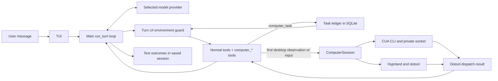

# Computer use in the main Oryn loop

This chapter records the computer-use integration in the TUI's ordinary conversation. The older `src/computer.py` and `src/providers/computer.py` planner remain as legacy code and are not used by this path. The measurements in the [earlier perception plan](18-computer-perception-plan.md) and [CUA trial](20-cua-driver-hyprland-experiment.md) motivated the design; they are not benchmarks of this integration.

## Goal and ownership

The selected Oryn model owns the user's task, chooses from the ordinary tool catalog, interprets observations, and decides when to stop. The main conversation loop owns tool rounds, budgets, cancellation, context selection, and saved history. When the TUI model supports image input, `computer_*` tools are available alongside Oryn's other tools. `computer_task` records a model-maintained task contract without starting the desktop driver. A `ComputerSession` is created only when a desktop observation or input is requested. CUA Driver observes windows, accessibility state, and screenshots, and verifies native predicates through the installed `cua-driver serve` process and `cua-driver call` over a private socket. Oryn does not use CUA's MCP transport or ComputerAgent planner. Dotool dispatches all input, including coordinate clicks and clicks derived from numbered CUA control frames, as well as keyboard input, text, right clicks, and scrolling.



The responsibilities stay in separate modules: the [TUI](../tui_app.py) adds local desktop tools to its normal catalog and supplies the task-store callbacks and lazy desktop factory; the [conversation loop](../agent/conversation_loop.py) advertises tools, enforces the declared local/remote environment, and manages history; [ComputerTaskLedger](../agent/computer_task.py) validates the model's task record; [ComputerSession](../tools/computer_session.py) validates observations and actions; the [CUA adapter](../tools/cua_driver.py) owns the CLI/socket process; and the [Codex](../providers/codex.py) and [Gemini](../providers/gemini.py) providers translate image-bearing tool results into their API formats. The [session store](../session/sqlite_store.py) keeps the task record separately from the text transcript and context summary.

## How the computer-agent parts map to Oryn

| Part | Current owner and behavior |
| --- | --- |
| Goal and progress | The model can create a `computer_task` record with goal, constraints, done checks, steps, facts, and evidence. SQLite keeps it across chat turns and Oryn includes it in later model requests. This is model-maintained memory, not a machine verdict. |
| Action choice | The model chooses among project, browser, MCP, and `computer_*` tools in the ordinary turn. A declared `local_desktop` task cannot use remote Firecrawl `browser_*` actions in that turn; a `remote_browser` task cannot use desktop observation/input. `mixed` is explicit. |
| Permission gate | The existing tool callbacks request approval. For desktop input, the model marks consequential actions; Oryn reobserves after approval before dispatch. |
| Fast execution | `computer_act` sends one input or a bounded focus/edit sequence, then captures one fresh observation. This saves model rounds for predictable typing flows. |
| Observation | `mode=active` binds the focused Hyprland window to a unique CUA window in one model call, falling back to a desktop image when needed. CUA provides bounded accessibility controls, screenshots, and native predicates. Dotool-only mode provides desktop screenshots. |
| Verification | CUA checks supported exact predicates; the model checks a fresh image for visual outcomes. `image=false` can skip the image after a satisfied native check. A sent input or a task-ledger claim alone does not establish task success. |
| Trace | `ComputerTrace` links tool calls, observations, input steps, checks, and resulting state when logging is enabled. |

## Decisions and reasons

| Decision | Reason | Cost or limit |
| --- | --- | --- |
| Let the selected model choose desktop tools inside the same `run_turn` loop and normal conversation as its other tools. | The model keeps prior chat context and can combine local desktop actions with web, project, terminal, browser, or MCP tools when the task calls for them. Oryn creates a `ComputerSession` only after a desktop observation or input; Dotool is invoked only for input. | Five computer tool schemas and compact guidance add context to TUI requests for image-capable models. The first desktop observation still pays CUA startup time; ordinary answers and task-record updates do not. The model still needs a round after each action call to inspect fresh state. |
| Keep the task contract in SQLite and inject only a bounded record. | Goal, constraints, steps, facts, and claimed evidence survive compaction and interrupted turns. The model can start the task record and request the first observation in one response. | The record is model-maintained; it cannot replace a native predicate, file check, or visual assessment. Saved facts can include private UI text. |
| Bind the first interactive UI environment for the current turn. | A local-desktop task cannot accidentally open the separate Firecrawl browser to verify local state. A remote-browser task cannot send local desktop input. A `computer_task` declaration can bind the route up front; otherwise first use binds it. An existing task can be upgraded to `mixed` with a reason when the user's task truly needs both. | The model declares mixed use; Oryn does not infer app semantics from names. Public web search/extraction and project tools remain available with either route. |
| Keep CUA on `serve` plus `call` over a private CLI socket. | That is the installed route used in the local trial. Planning and transport are separate choices, so the new task flow does not need an MCP migration. | Each CLI call has process and serialization overhead. We have not compared that overhead with MCP in this flow. |
| Use CUA only for window discovery, accessibility, screenshots, and native verification; use dotool for every input, including clicks. | The accessibility tree still helps identify a control, but recent Hyprland click attempts returned an unsupported `global_input` route. Dotool already sends pointer input and keyboard/text input through the same local driver. | Dotool clicks are coordinate based and normally `unverifiable`; they require fresh state inspection. A numbered control without a safely mappable frame is refused. This does not establish that every app or Wayland surface will accept dotool input. |
| Prefer an exact CUA window, with a desktop route for launchers and surfaces without a usable window image. | `mode=active` selects a unique CUA window by current Hyprland process and geometry without a model round for listing. A `pid` plus `window_id` keeps later observations and native predicates tied to that window. | Active mode returns a desktop image if no unique CUA match exists. Other exact-window reads require supplied IDs. Desktop input rejects a changed active-window stamp. These checks cannot prove page content stayed still. |
| Bound each observation and send its image only to the next model response. | The model needs pixels for visual UI and accessibility labels for semantic controls. A 500-element tree, 1200-pixel screenshot edge, and optional tree-only read bound the payload. Keeping old images out of later context avoids repeatedly sending the same screenshot; text outcomes remain in history. | A scaled image can hide fine details, and the saved transcript cannot reconstruct an old screenshot. The model can request a fresh view when needed. |
| Consume one `observation_id` for one input or a bounded focus/edit sequence, then return a fresh observation. | The ID and numbered-control mapping stop reuse of a stale snapshot. A 2–3 step sequence saves model rounds for predictable typing; each later step checks that the target window remains the same. | Oryn cannot see in-window content changes between steps. It stops on a changed target or uncertain input, and returns the steps already attempted. A reported dispatch or `unverifiable` effect is not proof that the UI changed. |
| Keep general skills available while providing concise desktop-use guidance with the desktop tools. | A normal Oryn turn can need a computer skill as well as a project or domain skill. The existing `load_skill` path remains available; no second skill catalog or separate mode is needed. | The model may spend a tool round loading an environment-specific skill when one is relevant. |
| Interpret action effects as delivery evidence and recover only from fresh state. | The Driver and Hermes guidance both emphasize reading structured effects, checking state before retrying uncertain input, and treating escalation hints as signals rather than automatic commands. This addresses duplicate input after `unverifiable` results and repeated malformed calls. | Dotool reports that input was sent, not that the UI changed. The model must inspect the fresh observation before retrying. |
| Use CUA `verify_state` for exact native conditions; use `min_age_ms` for visual loading. | A native predicate can wait locally, with cancellation, for up to ten seconds without repeatedly asking the model to interpret screenshots. For a visual-only condition, model thinking time counts toward the requested image age, followed by one capture. | Native verification covers only supported window and element predicates. `unknown` stays unknown. A visual wait gives a fresh image, not an automatic proof of success. |
| Skip a screenshot only after a satisfied exact native check when requested. | `image=false` on `computer_act` or `computer_wait` avoids image capture and upload when the predicate itself is enough for the next decision. | A failed or unknown check still captures an image. A tree-only result cannot ground new pixel coordinates. |
| Keep local desktop control distinct from native `browser_*` tools while making both available in normal chat. | Oryn's native browser tools use a remote Firecrawl session; `computer_*` acts on the local desktop. Their descriptions tell the model which environment each controls. A search result cannot prove what is visible locally. | Having both sets in one catalog makes the environment distinction important; model selection errors remain possible and need evaluation. |
| Reobserve after approval and require the model to reissue the same marked action or sequence. | An approval dialog can change focus or screen state. The user should approve concrete input, and the model should inspect the current target before dispatch. | The model is instructed to mark sending, deleting, buying, publishing, and submitting. This is not a complete semantic classifier for every risky action; unmarked computer input does not automatically trigger this computer-specific prompt. |

The old planner, CUA ComputerAgent, and a separate browser or site-specific polling layer are not part of this TUI path. The current tools are designed for general desktop tasks, with exact native checks where available and fresh visual evidence elsewhere. The [ComputerSession source](../tools/computer_session.py) is authoritative for supported actions and predicate fields.

## One interaction

1. For a substantial task, the model calls `computer_task(operation="start", ...)` with a goal, constraints, done checks, steps, and UI environment. The result is saved per chat. Later record calls can mark steps working, verified, or blocked, mark done checks verified with evidence, and carry sourced facts between apps. A finish call requires evidence plus all planned steps and done checks marked verified before `complete`; these are still model claims that must match actual tool results. The model can request the first observation in the same response as the task record.
2. If the desired app is focused, `computer_observe({"mode":"active"})` matches the Hyprland active window to one CUA window by PID and bounds, then returns its tree and image; when matching is unavailable, it returns a desktop image. For another named app, the model calls `mode="windows"` to see IDs, then `mode="window"` with exact `pid` and `window_id`. Mode-specific shapes include `{"mode":"active"}`, `{"mode":"windows"}`, `{"mode":"window","pid":811,"window_id":42}`, and `{"mode":"desktop"}`. The wrapper discards irrelevant optional fields on windows and desktop calls instead of forwarding them to CUA, but the model is instructed to omit them. The schema intentionally does not enforce the window-only PID/ID constraints globally: providers may validate irrelevant default fields before the wrapper can discard them. The window handler enforces `pid > 0` and `window_id >= 0` when that mode is selected. A listing invalidates an older actionable observation, so the model observes the selected window again before input. Desktop mode is available for launchers and surfaces without an exact window target. There is no automatic one-second switch period.
3. A window read asks CUA for at most 500 accessibility elements and a screenshot capped at a 1200-pixel long edge. A later `image=false` read can skip the image. If Wayland cannot prove a window screenshot, Oryn matches and focuses the exact Hyprland window, refreshes its tree, then captures a desktop image. The result names the image coordinate scope. If the match is ambiguous, observation fails safely and the model can choose another route.
4. The model calls `computer_act` with `action` for one input, or `actions` for a 2–3 step focus/edit sequence, and the current `observation_id`. A sequence requires one single-line `type` step, may use keys, and may start with one click. Pressing Enter can only be its final step. It also supplies `expected_result` so the next state has a concrete check. The ID is consumed before dispatch. A stale ID, absent numbered control, unmappable control frame, or point outside the current image/display is rejected without that requested input. Dotool receives every click, key, text, right-click, and scroll. For `click_element`, Oryn maps the current control frame to its center in the selected monitor's screenshot coordinate frame before Dotool dispatch. CUA is never called to click. For key chords, `super+w` is valid syntax and `leftmeta` is a standalone tap; Oryn rejects `leftmeta+w` before dispatch with a correction.
5. Oryn returns the Dotool outcome or per-step outcomes and a fresh observation in that same tool result. A sequence stops if a step is refused or uncertain, or if the target window changes before a later step. Earlier inputs may already have happened. Its text includes `screenshot_included:true/false`; when true, the matching screenshot is attached to that result. A window-scoped action normally observes that exact window, even when another app may have become visible. If the exact window can no longer be observed, Oryn tries a fresh desktop image and reports the window-observation error. A `windows` listing has no screenshot. The model inspects the image and status before choosing another action. `unverifiable` is about input-effect readback; it does not mean an image is absent or the action failed. A preflight refusal such as `active_window_changed` or `element_frame_unavailable` means the requested input was not sent. Unknown, timed-out, and interrupted actions are never replayed automatically.
6. If the next state is an exact native predicate, `computer_act.wait_for` or `computer_wait` calls CUA `verify_state` for that window, up to ten seconds, with cancellation. `unknown` remains unknown. `image=false` on those calls returns a tree-only observation after a satisfied check, or an image if the check fails or is uncertain. For loading visible only in the image, `computer_observe.min_age_ms` delays only until the previous image has the requested age, counting model thinking time, and then captures once. After an app-launch/focus shortcut whose returned image is unchanged or scoped to the old window, the model may do at most one bounded desktop observation (`mode:"desktop"`, `min_age_ms` up to 5000), then inspect and replan; a windows listing is not a visual wait result.
7. For a marked external action, Oryn asks for approval, reobserves, and requires a fresh matching action before sending input. `computer_ask_user` gathers a clarification without ending the turn.

For “turn on dark mode in Settings,” the task record can begin with:

```json
{
  "operation": "start",
  "goal": "Turn on dark mode in Settings",
  "environment": "local_desktop",
  "constraints": [],
  "done_checks": ["Settings shows dark mode selected"],
  "steps": ["Find the display setting", "Select dark mode and check the result"]
}
```

The model can request the first `computer_observe` in that same response. After the setting changes, it can record what the fresh observation or native predicate showed. The record preserves progress if the chat turn is interrupted; the observed UI state remains the evidence for success.

For a predictable browser navigation, the model can use one sequence after observing the local browser:

```json
{
  "observation_id": "current-observation-id",
  "actions": [
    {"type": "key", "key": "ctrl+l"},
    {"type": "type", "text": "https://example.com"},
    {"type": "key", "key": "enter"}
  ],
  "expected_result": "The browser starts opening example.com"
}
```

The tool checks the same target before typing and pressing Enter, returns an outcome for each attempted step, and captures one new image. A loading page may still need a later bounded observation. This sequence removes two model decisions and two intermediate screenshots when all three steps run; it does not guarantee a particular wall-clock speedup. An uncertain click or a changed UI should use a single action followed by observation.

## Action outcomes and recovery

The tool's `effect` reports what the input route could establish. It does not by itself prove the user's requested outcome.

| Effect or result | Interpretation and next step |
| --- | --- |
| `confirmed` | The driver has readback evidence for the input. Check the task postcondition before reporting completion. |
| `partial` | Only part of the input may have landed. Inspect fresh state and repair only what remains. |
| `unverifiable` | The input route accepted/sent input without proving its UI effect. It says nothing about screenshot presence. Inspect the attached fresh image when `screenshot_included:true` (or request a screenshot if false) before considering another action; dotool reports this normally. |
| `suspected_noop` | The driver has evidence that the action probably did not change the target. Inspect state and choose a reasoned next step. |
| `refused` | The selected route did not send the requested input. For Oryn preflight reasons such as `active_window_changed`, `target_focus_failed`, or `element_frame_unavailable`, the requested click/key was not dispatched; inspect the fresh observation before choosing another action. An escalation hint is not permission or an automatic retry. CUA is not a click fallback. |
| `unknown`, timeout, or cancellation | Input may or may not have occurred. Never replay automatically; observe first. |

## Failure diagnosis from the Fern desktop run

The original run exposed an evidence and tool-boundary error. After the desktop shortcut, Oryn's `computer_act` path returned a fresh desktop observation with its screenshot attached. The assistant's later self-report said it had not taken a screenshot and inferred failure from `unverifiable` plus the window stamp, but the tool flow did return an image. That image could support “Brave is not visible in this frame yet”; neither `unverifiable` nor an unchanged stamp proves the launch failed permanently. The new `screenshot_included` field makes image availability explicit alongside the image itself.

The assistant then used `browser_open` and `browser_click`. Those are native Firecrawl tools operating in a remote browser session, not local Brave or CUA. A malformed/stale element reference and a guessed URL led to the wrong video. With the integrated catalog, the model sees both remote and local browser capabilities; the tool descriptions and desktop guidance call out which environment each one controls. Only a fresh `computer_*` observation can verify what is visible on the local screen. If launching an app appears delayed, take at most one bounded settle observation before replanning. Do not guess a URL or repeat a shortcut to create a wait.

The staged Brave smoke run found two more interface gaps. First, the model sent `leftmeta+w`; dotool warned that `leftmeta` is not a chord modifier, and Oryn reported `unknown`. The key validator now rejects that combination before dispatch and tells the model to use `super+w` for a chord or `leftmeta` alone. Second, after `super+w` returned an image scoped to the original `foot` window, the model called `computer_observe(mode="windows", min_age_ms=1000)`. That call waits then lists window metadata; it does not capture pixels. The excerpt is truncated before the full list, so it does not establish whether Brave appeared there. The updated guidance directs app-launch settling to one full-desktop screenshot before claiming the app is visibly open.

Computer traces now record an MCP status snapshot at task start and the duration of each MCP tool-directory lookup before a model request. The snapshot includes aggregate lifecycle counts and per-server state/connect duration, but no credentials, URLs, or error text. Together, these timings show whether MCP startup or directory assembly accounts for time before a model request, or whether the delay happened elsewhere.

For invalid arguments, the model should use the error's correction guidance once and should not repeat unchanged arguments. The adapter currently projects mode-specific observation arguments before calling CUA, which prevents irrelevant `pid`, `window_id`, or `image` defaults from reaching the backend on windows/desktop calls. If a corrected call fails again or no exposed route can complete the task, stop and report the limitation.

The external guidance we adapted is the [Cua Driver workflow](https://github.com/trycua/cua/blob/main/libs/cua-driver/rust/Skills/cua-driver/WORKFLOW.md), [Hermes computer-use prompt guidance at commit `762bc75`](https://github.com/NousResearch/hermes-agent/blob/762bc75/agent/prompt_builder.py#L3254-L3540), and [Hermes computer-use skill](https://github.com/NousResearch/hermes-agent/blob/main/skills/autonomous-ai-agents/computer-use/SKILL.md). Their action vocabularies and recovery rungs are specific to their wrappers; Oryn keeps its own `computer_*` schema and only adopts the general snapshot, evidence, and recovery principles.

## Example: wait for an app setting

Suppose the user asks, “Turn on dark mode in Settings, and tell me when it is on.” These IDs and labels are illustrative; the real app must expose the corresponding control before the model can use it.

1. `computer_observe({"mode":"windows"})` lists the candidate windows. The model selects Settings by its returned `pid` and `window_id`, then calls `computer_observe({"mode":"window","pid":811,"window_id":42})`.
2. If the fresh tree already reports the “Dark mode” check box selected, the model can stop. If it reports an unselected numbered control, say `[7]`, the model sends one action tied to that observation:

   ```json
   {
     "observation_id": "the-current-observation-id",
     "action": {"type": "click_element", "element_index": 7},
     "wait_for": {
       "element": {
         "selector": {"role": "check box", "label_contains": "Dark mode"},
         "selected": true
       }
     },
     "wait_timeout_ms": 5000
   }
   ```

3. `computer_act` sends that one click through Dotool, asks CUA to verify the predicate if the action was not refused or unknown, and returns the verification result plus a fresh observation. A verified selected state supports completion. If verification is `unknown` or the control disappeared, the model examines the new tree and image, then chooses another observation, a visual check, or a clarification. It does not repeat the click merely because the predicate was unknown.
4. If the app exposes only a visual toggle or spinner, the model uses the desktop or window screenshot and may call `computer_observe({"mode":"window","pid":811,"window_id":42,"min_age_ms":2000})`. Oryn waits only for any remaining part of the two seconds since the prior capture, takes one new image, and lets the model assess it. There is no repeated screenshot loop hidden inside that call.

This example shows the conditional boundary: Dotool sends the click, native facts can be checked by CUA, and visual facts still require the model to interpret a new image. It does not assume every Settings app has an accessible “Dark mode” check box.

## Boundaries and cost

In the TUI, computer schemas are included in ordinary turns only when the selected provider confirms image input. The normal tools remain available and the model chooses whether to call `computer_*`. The old `/computer <task>` spelling is accepted as a compatibility alias, not a separate tool route; its `--dry-run` form still previews the first proposed input. Oryn creates a `ComputerSession` and starts CUA only when a computer tool is called; Dotool runs only when an input action is sent. The selected provider sends a screenshot as an image part of the corresponding tool result. After the next model response, Oryn drops the image bytes and replaces the old control list with a compact text summary; the action and verification outcomes and tool-call pairing remain in history. Normal context compaction and the normal turn budget still apply. The screenshot cap, bounded tree, optional tree-only read, one action per observation, and one final capture after a wait limit unnecessary model and image calls.

For dotool input to an exact window, Oryn matches CUA's pid and bounds to one Hyprland client, focuses it if required, and checks that focus changed. For desktop input, it rejects a changed active-window stamp. This does not prove arbitrary page content stayed unchanged during model thinking; the model still needs fresh observations and must treat tool feedback as evidence, not completion.

The dotool-only environment override retains desktop screenshots and actions, but has no CUA window directory or `verify_state`. Native CUA window screenshots can remain unavailable on Wayland. The task record and route guard are general; they do not attach a local browser DOM or discover app-specific scripting APIs automatically. A high-frequency game controller with HUD interpretation is not part of this desktop loop. This implementation has not been exercised in a new live end-to-end desktop run; the [earlier CUA trial](20-cua-driver-hyprland-experiment.md) describes the routes tested before this reform. The local baseline measured a 5.83-second median model response across 249 saved responses and a 673-millisecond median screenshot capture across five captures; those different samples explain why we tried to avoid redundant model and image calls, but they cannot predict this flow's task latency or cost.
